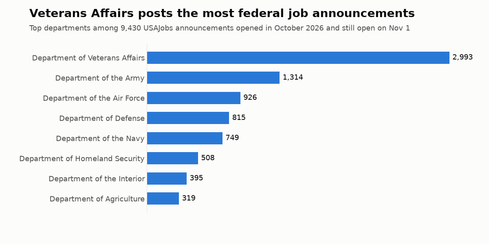

# Job market data

Free sample datasets of job postings, as CSV and Parquet, each with its columns and known limits.

| Dataset | What it is | Rows |
|---|---|---|
| [US federal job announcements, October 2026](data/us-federal-jobs-2026-10) | USAJobs pay, location, agency and full text, with contact details removed | 9,430 |



**On Kaggle:** [the full dataset](https://www.kaggle.com/datasets/artsiomkunitsyn/us-federal-job-announcements-october-2026) and [a notebook on pay by department](https://www.kaggle.com/code/artsiomkunitsyn/which-us-federal-departments-advertise-top-pay).

## Load it

```python
import pandas as pd
url = "https://raw.githubusercontent.com/Malodar/job-market-data/main/data/us-federal-jobs-2026-10/jobs_metadata.csv"
jobs = pd.read_csv(url)
print(jobs.department.value_counts().head(10))
```

## Get the full, current data

This is a snapshot from 2026-11-01. Every open posting, refreshed whenever you run it, comes from the [USAJobs Scraper](https://apify.com/artsiom_k/usajobs-scraper) on Apify (pay per result), and `examples/` shows how to run it from Python.

More of my scrapers: https://apify.com/artsiom_k

## License

Code: MIT (`LICENSE`). Data: CC BY 4.0 (`data/LICENSE`); the announcement text itself is public domain.
