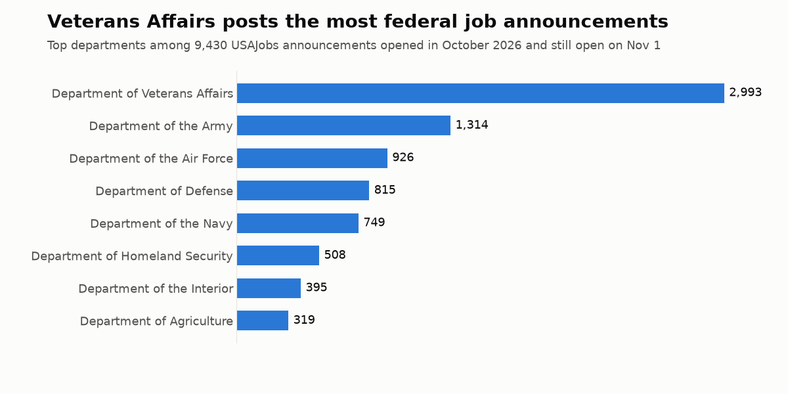

# US federal job announcements, October 2026

9,430 USAJobs announcements opened in October 2026 and still open on 2026-11-01, with pay, location, agency and the full announcement text.

**First look:** the median yearly posting pays $83,265 to $121,492, and 33% of announcements are telework eligible.

- `jobs_metadata.csv`: all 9,430 rows, without the long text columns
- `jobs_sample_300.csv`: a random 300 rows with full text
- `jobs_full.parquet`: all rows with full text, 45 MB. Download it from this repo's [Releases](https://github.com/Malodar/job-market-data/releases)

**On Kaggle:** [the full dataset](https://www.kaggle.com/datasets/artsiomkunitsyn/us-federal-job-announcements-october-2026) and [a notebook on pay by department](https://www.kaggle.com/code/artsiomkunitsyn/which-us-federal-departments-advertise-the-highest).

## Preview

| title | department | location | minimum_range_usd | maximum_range_usd | salary_period | telework_eligible |
|---|---|---|---|---|---|---|
| Program Analyst  (Space Operations) | Department of the Air Force | Multiple Locations | 50964.0 | 121183.0 | year | False |
| Program Analyst (Space Operations) | Department of the Air Force | Multiple Locations | 62339.0 | 121183.0 | year | False |
| Program Analyst(Cyber Operations) | Department of the Air Force | Multiple Locations | 50964.0 | 121183.0 | year | False |
| Program Analyst (Cyber Operations) | Department of the Air Force | Multiple Locations | 62339.0 | 121183.0 | year | False |
| Teacher (Substitute) | Department of Defense | Multiple Locations | 24.57 | 24.57 | hour | False |

## Columns

| Column | Meaning |
|---|---|
| `external_id` | USAJobs control number |
| `url` | Link to the announcement |
| `title` | Job title |
| `agency` | Hiring agency |
| `sub_agency` | Sub-agency |
| `department` | Federal department |
| `location` | Location text |
| `location_count` | Number of duty locations |
| `minimum_range_usd` | Lowest pay in the range, USD |
| `maximum_range_usd` | Highest pay in the range, USD |
| `salary_period` | Pay period, mostly year or hour |
| `low_grade` | Lowest grade |
| `high_grade` | Highest grade |
| `job_grade` | Pay plan, e.g. GS |
| `work_schedule` | Full-time, part-time and so on |
| `work_type` | Permanent, term and so on |
| `relocation` | Relocation assistance |
| `hiring_paths` | Who may apply, separated by semicolons |
| `job_categories` | Occupational series, separated by semicolons |
| `position_start_date` | Date the announcement opened |
| `position_end_date` | Date the announcement closes |
| `summary` | Full text: summary |
| `duties` | Full text: duties |
| `how_you_will_be_evaluated` | Full text: evaluation |
| `required_documents` | Full text: required documents |
| `conditions_of_employment` | Full text: conditions |
| `qualifications` | Full text: qualifications |
| `education` | Full text: education |
| `additional_information` | Full text: additional information |
| `promotion_potential` | Highest promotion grade |
| `telework_eligible` | Telework eligible |
| `remote_job` | Remote job |
| `travel_required` | Travel requirement |
| `appointment_type` | Appointment type |
| `supervisory_status` | Supervisory position |
| `service_type` | Competitive or excepted service |
| `union` | Bargaining-unit note |
| `drug_test` | Drug test required |
| `position_sensitivity` | Sensitivity and risk level |
| `security_clearance` | Clearance required |
| `announcement_number` | Agency announcement number |

## How it was collected

From USAJobs.gov on 2026-11-01. Announcement text is a US-government work.

## Personal data removed

Contact name, email, phone and address columns and the how-to-apply text are removed. Emails, phone numbers and named contacts were also stripped from the remaining text with automatic rules, shown as `[email removed]`, `[phone removed]` and `[name removed]`. This is best effort, so a name can remain in free text. If you find one, please open an issue.

## Known limits

- **Only announcements still open on 2026-11-01.** Those that opened in October and already closed are missing, so this isn't every October posting.
- `position_start_date` is when the announcement opened, not when the job starts.
- A few announcements contain characters damaged at the source.
- One announcement can cover many locations and openings, so rows aren't a count of jobs.

## Full and current data

Every open posting, refreshed whenever you run it: https://apify.com/artsiom_k/usajobs-scraper
(runs on Apify, pay per result). This sample is a snapshot from 2026-11-01.

License: CC BY 4.0 for this compilation. The announcement text itself is public domain.
